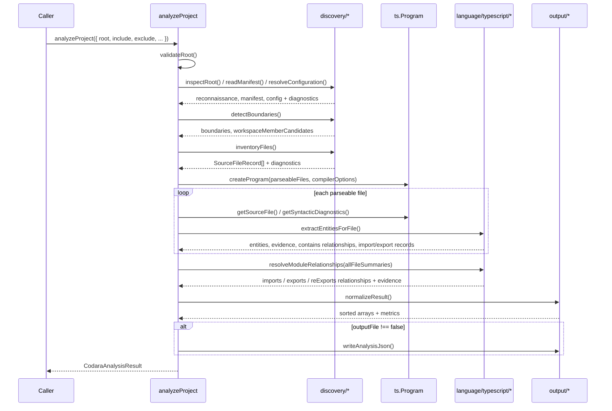

# Project Discovery

> **Status:** Fully implemented in Phase 1. This document describes the actual pipeline in
> `src/application/analyze-project.ts` and `src/discovery/*`, not a future design.

Project discovery is the part of Codara that answers: _what are we analyzing, where are its
boundaries, and which analyses are possible?_ It runs once per `analyzeProject(...)` call, before
any AST parsing happens, and its output (the [Project Model](../semantic-model.md#project-model))
is what everything downstream — entity extraction, relationship resolution — is scoped against.

## Pipeline overview

1. **Root validation and session creation**
2. **Root reconnaissance**
3. **Manifest interpretation**
4. **Configuration resolution**
5. **Project-boundary and workspace-signal detection**
6. **Controlled file inventory**
7. **File classification**
8. **Shallow parsing** (see [03-semantic-entity-model.md](03-semantic-entity-model.md))
9. **Cross-file relationship resolution** (see [04-relationship-model.md](04-relationship-model.md))
10. **Result normalization**
11. **Canonical JSON output and console summary**

### 1. Root validation and session creation

`analyzeProject` resolves `options.root` to an absolute path and validates it before doing anything
else: the path must exist and must be a directory. A missing or non-directory root throws a typed
`CodaraInvocationError` (`root-not-found` / `root-not-directory`) — the only case where the library
throws rather than returning diagnostics, because there is no project to describe at all.

A run identifier, start timestamp, and analysis mode (`"standard"`, always, in Phase 1) are
recorded as part of the volatile `AnalysisRunSummary` returned in `result.run` — kept separate from
the deterministic semantic output (see [06-evidence-and-confidence.md](06-evidence-and-confidence.md#determinism)).

### 2. Root reconnaissance

`src/discovery/inspect-root.ts` performs a single, non-recursive `readdir` of the root directory.
It does not construct a TypeScript `Program` and does not read file contents. From that one listing
it determines:

- Whether `package.json`, `tsconfig.json`, `jsconfig.json` are present.
- Which lockfile is present (`package-lock.json`, `yarn.lock`, `pnpm-lock.yaml`, `bun.lock(b)`),
  used only to infer the likely package manager.
- Which "notable" directories exist (`src`, `lib`, `app`, `packages`, `apps`, `test`, `tests`,
  `coverage`) — a cheap signal used later for [boundary detection](#5-project-boundary-and-workspace-signal-detection).

### 3. Manifest interpretation

`src/discovery/read-manifest.ts` reads `package.json` when present and extracts: `name`, `version`,
module type (`"module"` → `esm`, `"commonjs"` → `commonjs`, anything else → `unknown`), `scripts`,
the dependency/devDependency name lists, and `workspaces` patterns (both the array form and the
`{ packages: [...] }` object form).

A missing `package.json` is not an error — analysis proceeds with `manifest: undefined` and the
project is simply treated as unidentified (`project.id` falls back to `"project:root"`; see
[03-semantic-entity-model.md#identity](03-semantic-entity-model.md#deterministic-ids)). A malformed
`package.json` (invalid JSON, or valid JSON that isn't an object) produces a `manifest-parse-error`
or `manifest-invalid-shape` diagnostic and analysis continues without manifest data — Phase 1
always prefers a partial result to aborting.

### 4. Configuration resolution

`src/discovery/resolve-configuration.ts` looks for `tsconfig.json`, then `jsconfig.json`, in the
root. If neither exists, Phase 1 falls back to permissive default compiler options (`allowJs`,
`target: ES2022`, `jsx: preserve`, `module: ESNext`, `moduleResolution: Bundler`) and reports no
`typeScriptConfig` signal.

If a config file exists, it is read and parsed using the classic TypeScript Compiler API
(`ts.readConfigFile` + `ts.parseJsonConfigFileContent` — see
[09-runtime-and-performance.md](09-runtime-and-performance.md) for why this API is available at
all). A read error (e.g. malformed JSON) or parse errors both produce warning-level diagnostics
(`tsconfig-read-error` / `tsconfig-parse-error`) rather than aborting, and analysis continues with
the permissive defaults. When parsing succeeds, the resolved compiler options are merged over the
defaults, and a `TypeScriptConfigSignal` is recorded: `allowJs`, `checkJs`, `jsx`, `module`,
`moduleResolution`, `target`, `sourceMap`, `paths`, `baseUrl`, `projectReferences`, and the raw
`include`/`exclude` arrays from the config file.

One default is applied regardless of what a project's `tsconfig.json` says: `compilerOptions.types`
defaults to `[]` unless the config explicitly sets it. Without this, the TypeScript compiler
silently adds every package under `node_modules/@types` as an implicit root file, pulling ambient
declarations that have nothing to do with the project into the entity set. Phase 1 selects its own
file list via the [controlled file inventory](#6-controlled-file-inventory), not via the config's
resolved file list, so this implicit behavior is suppressed by default.

### 5. Project-boundary and workspace-signal detection

`src/discovery/detect-boundaries.ts` always reports a `packageRoot` boundary at `.`. If the
manifest declared `workspaces`, it additionally reports a `workspaceRoot` boundary and sets
`capabilities.workspaceDetected = true`. Notable directories found during reconnaissance
(`src`/`lib`/`app` → `sourceRoot`, `test`/`tests` → `testRoot`) are recorded as further boundaries.

When a workspace is detected, each `workspaces` glob pattern (e.g. `"packages/*"`) is expanded by
listing the static, non-wildcard prefix directory and collecting its immediate subdirectories —
**not** by recursing into each member and analyzing it as its own project. The result is a sorted
list of `workspaceMemberCandidates` (e.g. `["packages/pkg-a", "packages/pkg-b"]`) — a signal for a
future phase, not a promise that those members were analyzed.

**Current limitation:** workspace members are candidates only. Phase 1 supports a single-package
root robustly; full multi-package semantic resolution (walking into each member, building a
project graph per package, cross-package relationship resolution) is explicitly out of scope for
Phase 1.

### 6. Controlled file inventory

`src/discovery/inventory-files.ts` walks the root recursively, skipping symlinks entirely (both
directory and file symlinks) to avoid cycles and ambiguity. At each directory, entries are sorted
by name before further processing, which is part of what makes the resulting file list
deterministic regardless of the host filesystem's own directory-entry ordering.

**Default-excluded directories** (never descended into, regardless of `include`):

```text
.git  node_modules  dist  build  out  coverage  .nyc_output
.cache  .turbo  .next  .codara  tmp  temp
```

(`src/discovery/default-exclusions.ts` is the single source of truth for this list.)

**User `include`/`exclude` patterns** are supported as an additional filter, using a small,
dependency-free glob matcher (`src/discovery/glob.ts`, supporting `*`, `**`, `?` against
project-relative POSIX paths):

- `exclude` patterns matching a directory prevent descending into it; patterns matching a file
  remove it from the inventory entirely.
- `include` patterns, if any are given, act as an allowlist — only files matching at least one
  `include` pattern are kept (after `exclude` has already been applied).

**Resource budgets:** each file is checked against `maxFileSizeBytes` (default 5 MiB) and the walk
as a whole is capped at `maxFiles` (default 20,000). A file over the size limit is still recorded
in the inventory (with `exclusionReason: "file-too-large"` and `shouldParse: false`) rather than
silently dropped; reaching the file-count limit truncates the walk and emits a single
`file-count-limit-reached` diagnostic rather than continuing silently.

### 7. File classification

Every discovered file is classified by `src/discovery/classify-file.ts`, using only its
project-relative path, filename, and extension — no file content is read for classification. The
checks run in a fixed priority order, first match wins:

1. **Declaration** — `*.d.ts` / `*.d.mts` / `*.d.cts` (never parsed).
2. **Build output** — any path segment named `dist`, `build`, or `out`.
3. **Fixture** — any path segment named `fixtures`, `__fixtures__`, or `__mocks__`.
4. **Generated** — filename contains `.generated.` or a `generated` path segment.
5. **Test source** — a `test`/`tests`/`__tests__` path segment, or a `*.test.*`/`*.spec.*`
   filename.
6. **Configuration** — a known config filename (`package.json`, `.eslintrc*`, etc.), a recognized
   `*.config.*` naming pattern (`tsconfig`, `vitest.config`, `webpack.config`, ...), or a
   configuration-typed extension (`.json`/`.yaml`/`.yml`/`.toml`/`.ini`) with no recognized source
   language.
7. **Script** — a `scripts`/`bin` path segment.
8. **Production source** — any remaining file with a recognized `.js`/`.jsx`/`.ts`/`.tsx`/`.mjs`/
   `.cjs`/`.mts`/`.cts` extension.
9. **Unknown** — everything else (e.g. `.md`, images).

Only files classified as production or test source with a recognized language get
`shouldParse: true` — that flag, not the classification alone, is what determines whether a file
enters the AST-parsing stage.

### 8–9. Shallow parsing and relationship resolution

Covered in full in [03-semantic-entity-model.md](03-semantic-entity-model.md) and
[04-relationship-model.md](04-relationship-model.md). In short: all `shouldParse` files are handed
to a single `ts.Program` (built from the resolved compiler options), each file's AST is walked to
extract entities and per-file containment relationships, and import/export specifiers collected
during that walk are resolved against the full file inventory afterward, once every file's entities
are known.

### 10. Result normalization

`src/output/normalize-result.ts` sorts `files` by `relativePath`, and `entities`/`relationships`/
`evidence` by `id`, and `diagnostics` by `(filePath, code, message)` — the same sort every time,
regardless of processing order — and derives `Phase1Metrics` (file/entity/relationship counts) from
the sorted arrays. This is what makes two runs over identical source produce equivalent output; see
[06-evidence-and-confidence.md#determinism](06-evidence-and-confidence.md#determinism).

### 11. Canonical JSON output and console summary

If `outputFile` is not `false`, the normalized result is serialized as pretty-printed JSON (2-space
indent, trailing newline) to the requested path (default `.codara/analysis.json`), creating parent
directories as needed. The CLI additionally prints a concise, human-readable summary (project name,
module system, file/entity counts, diagnostic counts, output path) — see
[08-public-api.md](08-public-api.md#cli).

## Sequence diagram



## Current limitations (by design, not oversight)

- **Workspace members are candidates only** — no per-member discovery, classification, or parsing.
- **Path aliases (`tsconfig` `paths`) are recorded as configuration signal but not resolved** to a
  relationship target; see [04-relationship-model.md](04-relationship-model.md).
- **No type-checker binding** — `capabilities.symbolResolution` is always `false`. Phase 1 calls
  `program.getSyntacticDiagnostics()` only, never `getSemanticDiagnostics()` or `getTypeChecker()`.
- **No multi-package deep analysis** — a detected workspace does not trigger recursive analysis of
  its members.
- **No network access** anywhere in the discovery pipeline or the rest of Codara.
- **No absolute paths in persisted semantic locations** — every `filePath` in `SourceFileRecord`
  and `SourceLocation` is project-relative and POSIX-style, and `project.rootPath` is always the
  literal string `"."`, never the resolved absolute root.

---

Previous: [01 — Mental Model](01-mental-model.md) · Next: [03 — Semantic Entity Model](03-semantic-entity-model.md)
